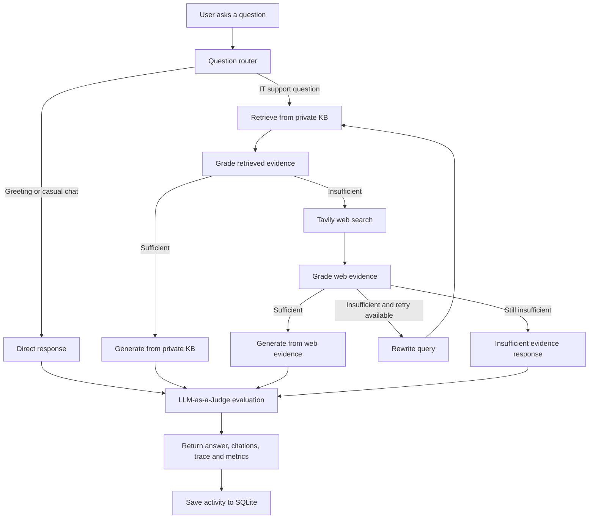

# IT Support Agent RAG

An enterprise-style IT Support Copilot that combines **agentic Retrieval-Augmented Generation (RAG)** with external web search and automated answer evaluation. It is designed to answer IT support questions using a private knowledge base first, fall back to web evidence when the internal material is insufficient, and expose the reasoning path, citations, and quality metrics through a web dashboard.

> **Project:** IT Support Agent RAG  
> **Backend:** FastAPI · LangChain · LangGraph  
> **Retrieval:** Pinecone · FastEmbed  
> **LLM providers:** Groq and Google Gemini  
> **Web search:** Tavily  
> **Observability:** LangSmith  
> **Evaluation:** LLM-as-a-Judge  
> **Frontend:** HTML · CSS · JavaScript

---

## Table of Contents

- [Overview](#overview)
- [Key Features](#key-features)
- [How It Works](#how-it-works)
- [Technology Stack](#technology-stack)
- [Architecture](#architecture)
- [Repository Structure](#repository-structure)
- [Getting Started](#getting-started)
- [Environment Configuration](#environment-configuration)
- [Index the Knowledge Base](#index-the-knowledge-base)
- [Run the Application](#run-the-application)
- [API Endpoints](#api-endpoints)
- [RAG Evaluation](#rag-evaluation)
- [Deployment](#deployment)
- [Testing](#testing)
- [Security Notes](#security-notes)
- [Limitations](#limitations)

## Overview

IT teams receive recurring requests involving password resets, VPN connectivity, multi-factor authentication, device configuration, software access, email, networking, cloud services, and general troubleshooting. Searching across handbooks, runbooks, and incident records can slow down support.

This project provides a conversational support interface backed by a retrieval and reasoning workflow. It:

1. Routes each incoming question to either a conversational response or the IT knowledge workflow.
2. Searches the private knowledge base using vector similarity.
3. Grades the retrieved evidence for relevance before generating an answer.
4. Uses Tavily web search when the private knowledge base does not provide sufficient evidence.
5. Rewrites the query and retries retrieval when web evidence remains weak.
6. Evaluates the final response for context relevance, groundedness, and answer relevance.
7. Logs the question, source, execution trace, and evaluation for later review.

The assistant is designed to avoid presenting unsupported troubleshooting instructions as verified company policy. When reliable evidence is unavailable, it returns an insufficient-evidence response.

## Key Features

### Agentic RAG workflow

A LangGraph state graph coordinates routing, retrieval, evidence grading, web search, query rewriting, answer generation, and evaluation.

### Private knowledge base first

The assistant searches the configured Pinecone index before using external sources. Answers based on internal content include private knowledge-base source citations.

### External search fallback

When internal evidence is insufficient, the workflow uses Tavily to retrieve external material. Web-based answers are identified as external information and should be validated before changing company-managed systems.

### LLM provider fallback

The application supports Groq and Google Gemini. When both provider keys are configured, the workflow can fall back to the secondary provider if the primary request fails; quota/rate-limit handling also routes subsequent model calls to the fallback.

### Automated RAG evaluation

An LLM judge scores three dimensions:

- **Context relevance:** whether retrieved evidence is relevant to the question.
- **Groundedness:** whether the answer is supported by the retrieved evidence.
- **Answer relevance:** whether the response addresses the user's question.

The evaluation includes an overall score, verdict, critique, metric explanations, and per-chunk assessments. A deterministic evaluator is used as a fallback if the model-based judge fails.

### Agent trace and citations

The chat interface displays the workflow trace and evidence used for the answer, making it easier to understand whether a response came from the private knowledge base, web search, or direct conversation.

### Activity and evaluation dashboard

SQLite stores query history, source information, traces, and evaluation results. Dashboard endpoints expose recent activity and aggregate evaluation metrics.

### Knowledge ingestion

The application supports ingestion of **PDF, DOCX, Markdown, and TXT** files. Uploaded documents are extracted, split into overlapping chunks, embedded, and stored in Pinecone.

### Observability

Optional LangSmith tracing helps inspect and debug the LangChain/LangGraph workflow.

## How It Works

The question-answering pipeline follows this sequence:



### Retrieval and generation

The default embedding model is `sentence-transformers/all-MiniLM-L6-v2`, served through FastEmbed. The application stores vectors in a Pinecone index using the configured namespace. The default retrieval setting is four final context chunks, after duplicate chunks are removed.

Documents are split using a recursive character text splitter with a chunk size of 1,000 characters and an overlap of 200 characters.

## Technology Stack

| Layer | Tools |
|---|---|
| API / application server | Python, FastAPI, Uvicorn |
| Agent orchestration | LangGraph |
| LLM integration | LangChain, Groq, Google Gemini |
| Vector database | Pinecone |
| Embeddings | FastEmbed, `all-MiniLM-L6-v2` |
| External search | Tavily |
| Document processing | PyPDF, python-docx, LangChain document loaders |
| Evaluation | Pydantic, LLM-as-a-Judge, deterministic fallback |
| Observability | LangSmith |
| Audit storage | SQLite |
| Frontend | HTML, CSS, JavaScript, Jinja2 |
| Deployment | Docker |

## Architecture

The code is organized into the following main components:

- `app/api/`: HTTP endpoints for chat, ingestion, health, activity, evaluation summaries, and LangSmith status.
- `app/core/`: application configuration and logging.
- `app/rag/`: LangGraph workflow, state definitions, Pinecone vector-store integration, and RAG evaluation.
- `app/services/`: document ingestion and SQLite audit logging.
- `templates/` and `static/`: browser interface and client-side assets.
- `data/sample_kb/`: sample IT support knowledge base.
- `tests/`: workflow and evaluation tests.
- `notebooks/`: exploratory RAG notebooks.

## Repository Structure

```text
IT-Support-Agent-RAG/
├── app/
│   ├── api/
│   │   └── routes.py
│   ├── core/
│   │   ├── config.py
│   │   └── logging.py
│   ├── rag/
│   │   ├── evaluation.py
│   │   ├── state.py
│   │   ├── vectorstore.py
│   │   └── workflow.py
│   ├── services/
│   │   ├── audit.py
│   │   └── ingestion.py
│   └── main.py
├── data/
│   └── sample_kb/
├── notebooks/
│   ├── agentic_rag.ipynb
│   └── simple_agent_rag.ipynb
├── src/
│   └── rag_agent/
├── static/
│   ├── css/
│   └── js/
├── templates/
│   └── index.html
├── tests/
│   ├── test_evaluation.py
│   └── test_workflow.py
├── .env.example
├── Dockerfile
├── ingest_sample_kb.py
├── pyproject.toml
├── requirements.txt
└── run.py
```

## Getting Started

### Prerequisites

- Python 3.11 or later
- A [Pinecone](https://www.pinecone.io/) account and API key
- At least one LLM provider API key: [Groq](https://console.groq.com/) or [Google AI Studio](https://aistudio.google.com/)
- A [Tavily](https://tavily.com/) API key for web fallback
- Optional: a [LangSmith](https://smith.langchain.com/) API key for tracing

### 1. Clone the repository

```bash
git clone https://github.com/thamosl/IT-Support-Agent-RAG.git
cd IT-Support-Agent-RAG
```

### 2. Create and activate a virtual environment

**Windows (PowerShell):**

```powershell
py -3.11 -m venv .venv
.venv\Scripts\Activate.ps1
```

**macOS / Linux:**

```bash
python3.11 -m venv .venv
source .venv/bin/activate
```

### 3. Install dependencies

Using pip:

```bash
python -m pip install --upgrade pip
pip install -r requirements.txt
```

Or, using uv:

```bash
pip install uv
uv sync
```

### 4. Configure environment variables

Create a local `.env` file from the example:

**Windows (PowerShell):**

```powershell
Copy-Item .env.example .env
```

**macOS / Linux:**

```bash
cp .env.example .env
```

Add your API keys and review the configuration values in the next section.

## Environment Configuration

The application reads its configuration from environment variables and the root `.env` file.

| Variable | Purpose |
|---|---|
| `GEMINI_API_KEY` | Google Gemini API key |
| `GROQ_API_KEY` | Groq API key |
| `PINECONE_API_KEY` | Pinecone API key |
| `PINECONE_INDEX_NAME` | Pinecone index name |
| `TAVILY_API_KEY` | Tavily web-search API key |
| `GEMINI_MODEL` | Gemini chat model used when Gemini is selected |
| `EMBEDDING_MODEL` | Embedding model name |
| `ADMIN_API_KEY` | Secret required by the document-ingestion endpoint |
| `LANGSMITH_TRACING` | Enables or disables LangSmith tracing |
| `LANGSMITH_API_KEY` | LangSmith API key |
| `LANGSMITH_PROJECT` | LangSmith project name |
| `LANGSMITH_ENDPOINT` | LangSmith endpoint |

Example configuration:

```env
GEMINI_API_KEY=your_gemini_api_key
GROQ_API_KEY=your_groq_api_key

PINECONE_API_KEY=your_pinecone_api_key
PINECONE_INDEX_NAME=it-support-rag
TAVILY_API_KEY=your_tavily_api_key

GEMINI_MODEL=gemini-3.6-flash
EMBEDDING_MODEL=sentence-transformers/all-MiniLM-L6-v2

ADMIN_API_KEY=replace_with_a_long_random_secret

LANGSMITH_TRACING=true
LANGSMITH_API_KEY=your_langsmith_api_key
LANGSMITH_PROJECT=IT-Support-Agent-RAG
LANGSMITH_ENDPOINT=https://api.smith.langchain.com
```

**Important configuration notes:**

- Configure at least one of `GROQ_API_KEY` or `GEMINI_API_KEY`.
- Configure both to enable provider fallback.
- Tavily is required for the external-search fallback path.
- The default `all-MiniLM-L6-v2` embedding model produces 384-dimensional vectors. The Pinecone index dimension must match the selected embedding model.
- Never commit your real `.env` file or API keys.
- Keep `ADMIN_API_KEY` private and replace any development default before deployment.

## Index the Knowledge Base

The repository includes sample IT support documents in `data/sample_kb/`.

Index the sample documents before asking questions that need private knowledge-base retrieval:

```bash
python ingest_sample_kb.py
```

The ingestion script:

1. Finds supported files in the sample knowledge-base directory.
2. Extracts their text.
3. Splits the documents into overlapping chunks.
4. Generates embeddings.
5. Adds the chunks to the configured Pinecone index and namespace.

The script prints the number of files, chunks, and vectors processed.

### Add documents through the API

The application also exposes an authenticated upload endpoint. It accepts PDF, DOCX, Markdown, and TXT files.

```bash
curl -X POST "http://localhost:8080/api/ingest" \
  -H "x-admin-key: YOUR_ADMIN_API_KEY" \
  -F "file=@path/to/your-handbook.pdf"
```

On success, the response reports the indexed file name, number of chunks, and number of vector IDs created.

## Run the Application

Start the development server:

```bash
python run.py
```

Or run Uvicorn directly:

```bash
uvicorn app.main:app --host 127.0.0.1 --port 8080 --reload
```

Open the application in your browser:

- **Web interface:** http://127.0.0.1:8080
- **Health check:** http://127.0.0.1:8080/api/health

The web interface includes the support chat, knowledge-base view, agent execution trace, evidence panel, and evaluation/activity dashboard.

## API Endpoints

| Method | Endpoint | Description |
|---|---|---|
| `GET` | `/` | Serves the web interface |
| `GET` | `/api/health` | Returns service health |
| `POST` | `/api/chat` | Runs the RAG agent for a question |
| `POST` | `/api/ingest` | Uploads and indexes a supported document (admin key required) |
| `GET` | `/api/activity` | Returns recent query activity |
| `GET` | `/api/evaluations/summary` | Returns aggregate evaluation metrics |
| `GET` | `/api/langsmith/status` | Reports LangSmith tracing configuration |

### Chat request example

```bash
curl -X POST "http://127.0.0.1:8080/api/chat" \
  -H "Content-Type: application/json" \
  -d '{"question":"How do I troubleshoot a VPN connection?"}'
```

The response includes:

- `answer`: generated assistant response
- `source_used`: route/source used for the response
- `trace`: workflow execution trace
- `citations`: private knowledge-base or web evidence references
- `evaluation`: judge metrics, verdict, critique, and chunk-level assessments

## RAG Evaluation

Every completed question passes through an evaluation stage.

| Metric | What it measures |
|---|---|
| Context relevance | Whether the retrieved chunks contain information relevant to the question |
| Groundedness | Whether the answer is supported by the available evidence |
| Answer relevance | Whether the answer responds to the user's question |
| Overall score | Weighted combination of the three metrics |

The overall score is calculated using the weights below when the judge does not provide its own overall score:

```text
Overall Score =
    (0.35 × Context Relevance)
  + (0.35 × Groundedness)
  + (0.30 × Answer Relevance)
```

The evaluation verdict is:

- **PASS:** score greater than or equal to 0.70
- **WARNING:** score from 0.40 to 0.69
- **FAIL:** score below 0.40

If the LLM judge cannot produce a valid evaluation, the system uses a deterministic fallback evaluator. Evaluation results and execution details are saved in the local SQLite audit database at `data/audit.db` by default.

> LLM-based evaluation is an automated quality signal, not a guarantee that an answer is factually correct or safe. Review critical IT instructions before applying them.

## Deployment

The repository includes a Dockerfile for containerized deployment.

Build the image:

```bash
docker build -t it-support-agent-rag .
```

Run the container:

```bash
docker run --rm -p 8080:8080 --env-file .env it-support-agent-rag
```

Then open http://localhost:8080.

The container starts the application with:

```bash
uvicorn app.main:app --host 0.0.0.0 --port $PORT
```

For a hosted deployment, configure the same environment variables in your hosting provider. Make sure the SQLite audit database and any required local files are stored on persistent storage if they must survive container restarts or redeployments.

## Testing

Run the test suite from the repository root:

```bash
python -m unittest discover -s tests -v
```

The tests cover workflow routing, private-KB retrieval, duplicate-chunk handling, web fallback, query rewriting and retry behavior, insufficient-evidence handling, provider fallback, chat API response fields, and evaluation behavior.

## Security Notes

- Store all provider credentials in environment variables or a secrets manager.
- Do not expose the admin ingestion key in frontend code.
- Use HTTPS in production.
- Restrict access to the ingestion endpoint and rotate the admin key if it is exposed.
- Validate and size-limit uploaded files before accepting them in a production environment.
- Treat web-search results as external, untrusted information.
- Avoid placing confidential company data into third-party LLM or search services unless the organization's data policies permit it.

## Limitations

- Retrieval quality depends on the completeness, freshness, and quality of the indexed documents.
- External web fallback requires a working Tavily API key and network access.
- Provider availability, rate limits, and model behavior depend on the configured services.
- SQLite is suitable for a lightweight project deployment; a multi-instance production system should use a shared persistent database.
- The LLM judge can make mistakes and should be treated as an evaluation aid rather than a formal certification of correctness.

## Author

**Thamotharan**

- GitHub: [@thamosl](https://github.com/thamosl)
- Project repository: [IT-Support-Agent-RAG](https://github.com/thamosl/IT-Support-Agent-RAG)

---

If you find this project useful, consider giving the repository a ⭐ on GitHub.
